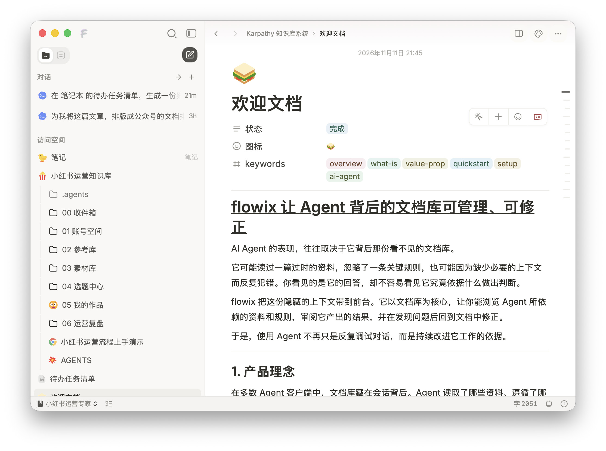
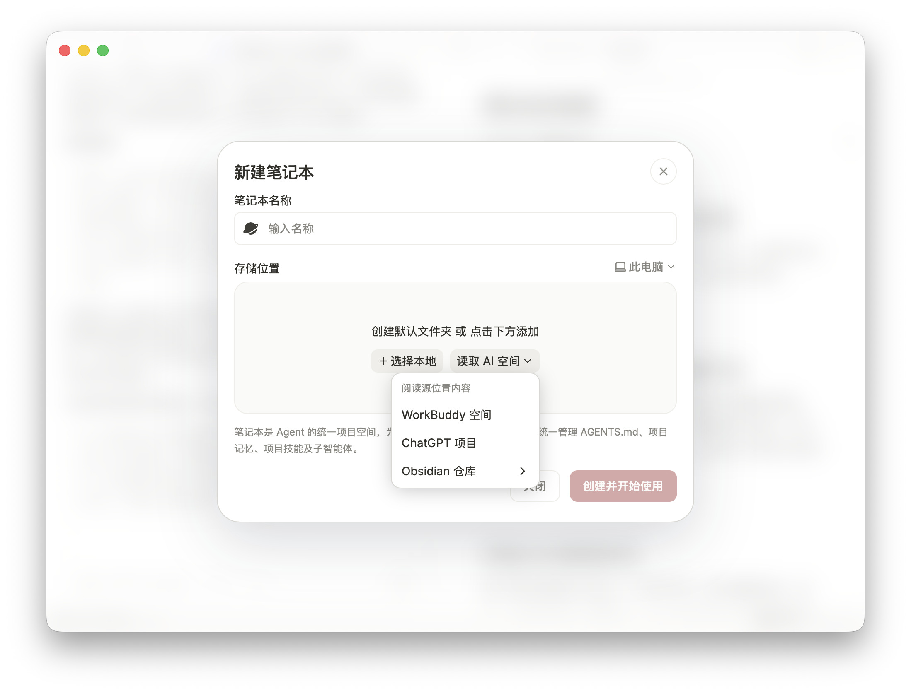
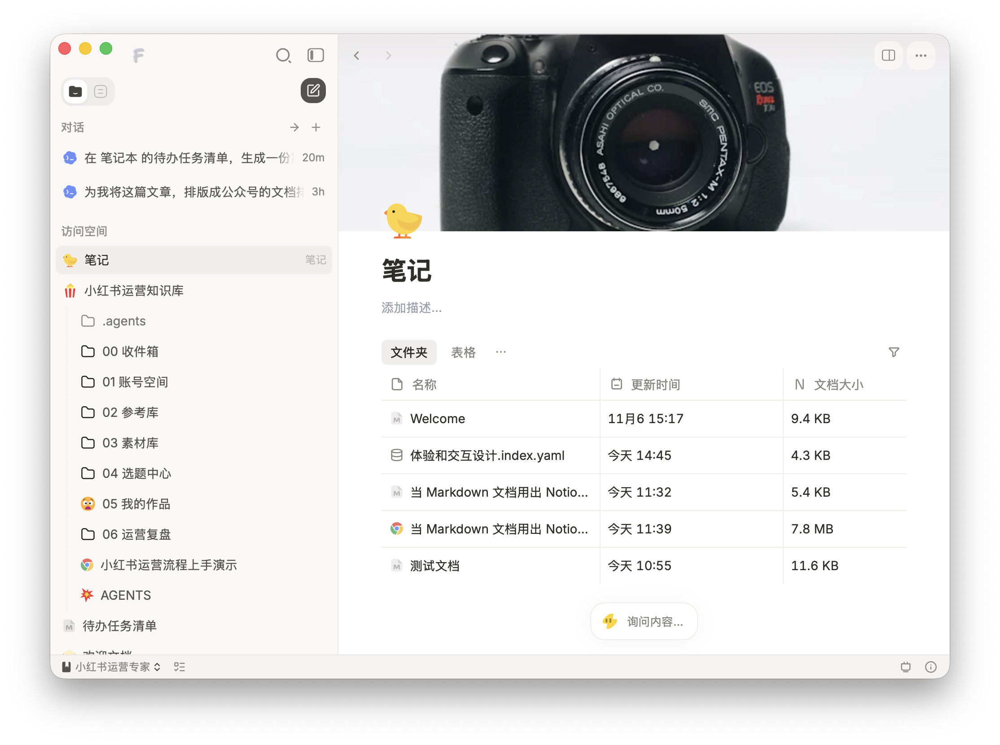
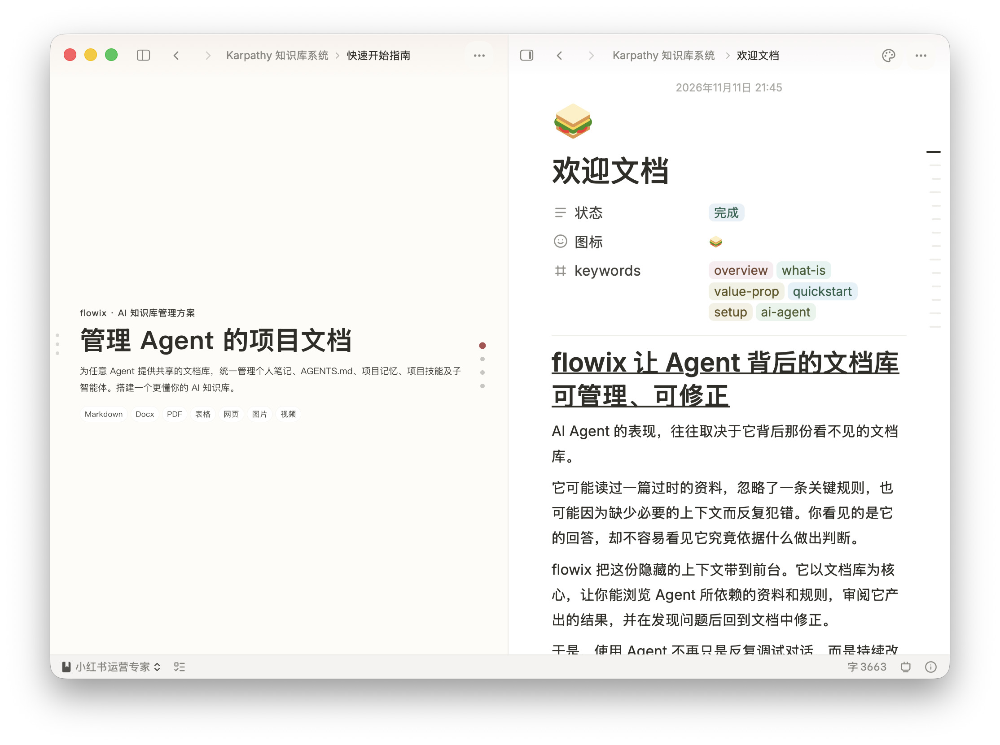
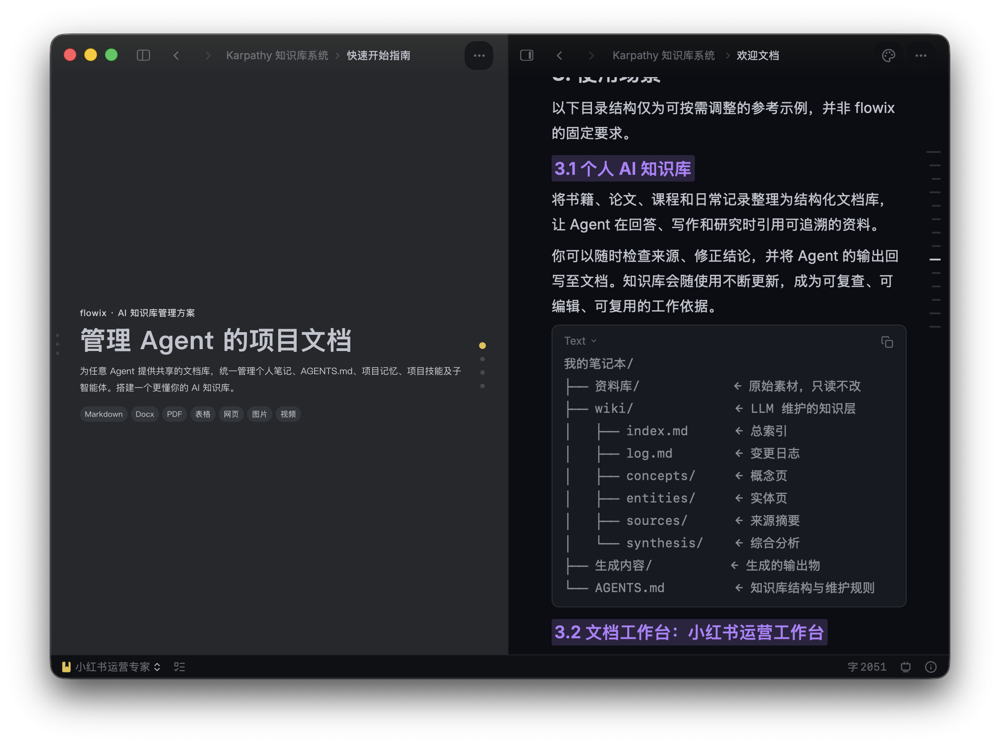
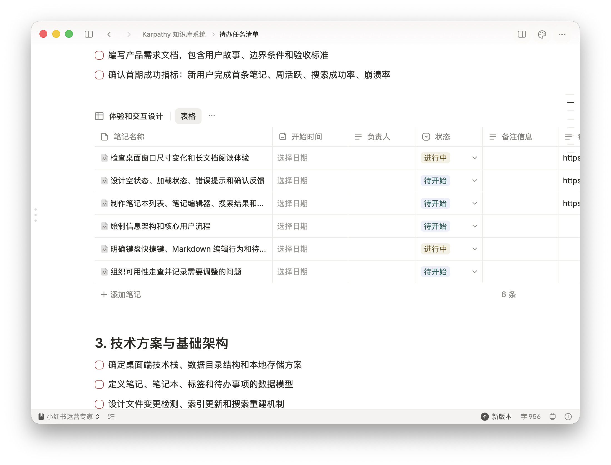

[English](./README.en.md) | **简体中文**
## 探索 AI Agent 工作空间
不知道 AI 在工作空间写了什么，记录了什么，任务成不成全靠缘分？flowix 帮你管理，让 AI 工作空间可视化。

继续了解 AI 工作空间  ↓↓↓
### 要点1：整理目录结构
一套高质量的结构，可以按照 **输入**、**过程**、**输出** 组织。
输入包括需求、日记、会议纪要、摘抄文章等。过程包括 AI 记忆（工作流、避坑指南、Skills、专家智能体等）、输出包括文章、网页作品、任务完成记录等。
Flowix 将这些上下文放进可浏览、可编辑的文档库。可以检查、调整，让后续工作建立在正确内容上。

### 要点2：整理输入资料
建立资料库（文件夹），将收集的资料（论文、研报、摘录）存入其中。利用 AI 帮你，收集事半功倍，但要注意 review 资料。
- AI 虽然掌握世界知识，但抽丝剥茧的过程，对于具体的场景才有意义。否则都是信息垃圾。
- 审核好自己的资料，如果不认可的，未经审计的，可以适当剔除。
### 要点3：安装 Skill 和 专家智能体
在笔记本中独立安装，避开项目之间的相互干扰。
如果你也遇到，明明想做 PPT，结果 AI 调用全局的网页Skill 开始设计网页，那你能感同身受。
这里推荐将必要的 AI Skill 和 专家智能体（比如资料收集、审查等），安装到工作空间内进行管理。
### 要点4：写简易工作流模板
一个文档即一个工作流。
比如你的竞品监控，有明确的监控对象、指标、频次等要求。不要每次都独立写提示词——请写一份工作流文档。
为什么不用技能？
技能也是文档，但技能不方便主动修改。技能太多容易误用。结合自身场景的技能，还是需要自己日常进行打磨。
### 要点5：问 AI 你该怎么做
你已经很聪明，但 AI 可以给你启发。
文档库就是你和 AI 共同的硬盘，AI 随时扫描内容给你更准确的建议。文档越多，我们越难以回想，但 AI 却可能更聪明。
但 AI 替代不了你的价值观，请评估 AI 的建议。不理解的，也可多问 AI 几个为什么。
## 上手指南
快速上手，一招学废
### 打开 AI 的工作空间
AI 工作空间，是大部分 Agent 都有的一个主文件夹。不论你看不看，他都在哪里，默默的影响 AI 。

### 使用 AI 为你整理
你可以在flowix内使用本地 AI ，也可以在 AI 客户端使用（共享文档库）。

### 管理文件夹和文档、作品
管理本地文件夹、文档、数据库（多维表格视图）。整体体验接近 Notion，额外扩展图片上下文能力、多皮肤、网页文件等。
<table style="width: 554px;"><colgroup><col style="width: 185px;"><col style="width: 185px;"><col style="width: 184px;"></colgroup><tbody><tr><td colspan="1" rowspan="1" colwidth="185"><div class="editor-image-attachment is-loaded" data-image-attachment="true" data-file-name="截屏2026-11-12 15.02.43.png" data-mime-type="image/jpeg" data-storage-mode="attachment" data-storage-key="./docs/images/readme-04.jpg"></div></td><td colspan="1" rowspan="1" colwidth="185"><div class="editor-image-attachment is-loaded" data-image-attachment="true" data-file-name="截屏2026-11-12 15.05.23.png" data-mime-type="image/jpeg" data-storage-mode="attachment" data-storage-key="./docs/images/readme-05.jpg"></div></td><td colspan="1" rowspan="1" colwidth="184"><div class="editor-image-attachment is-loaded" data-image-attachment="true" data-file-name="截屏2026-11-12 15.03.47.png" data-mime-type="image/jpeg" data-storage-mode="attachment" data-storage-key="./docs/images/readme-01.jpg"></div></td></tr><tr><td colspan="1" rowspan="1" colwidth="185"><div class="editor-image-attachment is-loaded" data-image-attachment="true" data-file-name="截屏2026-11-12 15.06.19.png" data-mime-type="image/jpeg" data-storage-mode="attachment" data-storage-key="./docs/images/readme-06.jpg"></div></td><td colspan="1" rowspan="1" colwidth="185"><div class="editor-image-attachment is-loaded" data-image-attachment="true" data-file-name="image.png" data-mime-type="image/jpeg" data-storage-mode="attachment" data-storage-key="./docs/images/readme-07.jpg"></div></td><td colspan="1" rowspan="1" colwidth="184"><div class="editor-image-attachment is-loaded" data-image-attachment="true" data-file-name="image.png" data-mime-type="image/jpeg" data-storage-mode="attachment" data-storage-key="./docs/images/readme-08.jpg"></div></td></tr></tbody></table>

## 开源安装说明
### 本地开发
```bash
git clone https://github.com/text2future/flowix.git
cd flowix
npm install
# 启动 Tauri 开发模式
npm run tauri:dev
# 构建生产版本
npm run tauri:build:prod
```
环境要求 `Node.js 20+`、 `Rust 1.75+` 与 `Tauri v2` ，桌面应用支持 `macOS 14+`  与 `Windows 10+` 。鸿蒙、Linux 等系统需自行探索体验。

## 许可协议
产品客户端源码基于 GNU AGPL 协议开源。

[体验产品](https://flowix-memo.com/)
